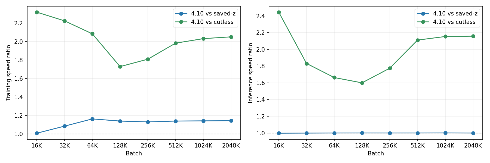
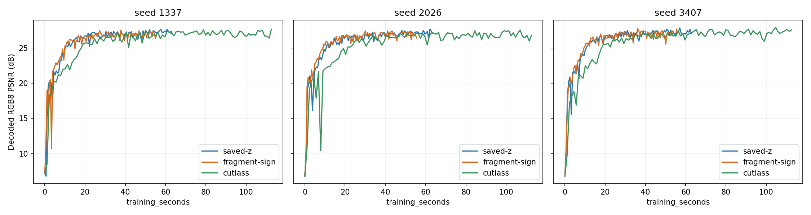

# Sine Measurement Evidence

These are measured data, not theoretical peak estimates. **RTX 5090 is the main
experimental platform**; RTX 4090 and A100 provide cross-architecture evidence.
Historical algorithm snapshots and final-source acceptance are labeled separately.
See [mode semantics and reproduction](../../sine.md) before comparing numbers.

## Data Files

- [metadata.json](metadata.json): hardware, precision, build settings, original
  network/loss/optimizer config, image hashes, timing scopes and reference gates.
- [throughput.csv](throughput.csv): 123 individual measurements: 72 historical
  RTX5090 eight-batch cases, 45 final-source cases across three GPUs, and six
  interleaved old/new SignRecon cases at batch65,536.
- [throughput-summary.json](throughput-summary.json): medians and full ranges,
  recomputed from the CSV records. Each group has three fresh-process repetitions.
- [quality-runs.json](quality-runs.json): 25 individual runs: 21 historical
  three-seed, 10,000-step cases and four final-source 1,000-step checks. Records
  include final/best quality, observed target times and reload verification.
- [quality-curves.csv](quality-curves.csv): 953 observed checkpoints: complete
  main-platform historical curves and final-source short checks. Times and PSNR
  are unmodified; targets use the first observed checkpoint, not interpolation.
- [historical-vjp.csv](historical-vjp.csv): 48 fixed-state synthetic VJP comparisons,
  including per-case parameter and first-hidden-layer errors. Upstream is signed
  scale/batch, not an actual RelativeL2 derivative or Adam update.
- [historical-numerics.json](historical-numerics.json): full-range FP16 scalar
  statistics, controlled-reference results and VJP scale diagnostic summaries.
- [source-identity.json](source-identity.json): common final core/test source
  hashes and staged Git blob identities, verified against three GPU archives.
- [checksums.json](checksums.json): SHA256 of the data and historical figures.

The evidence subtree enforces LF line endings for JSON/CSV/Markdown so these
data checksums survive Windows/Linux Git checkout; PNG checksums use raw bytes.

The RTX4090 timing runs preceded a whitespace-only final cleanup. Its post-cleanup
CTest, and all final A100/RTX5090 runs, use the common final files. Before/after
raw hashes are retained in metadata; this distinction is not hidden by the
`final-source` CSV label. Git blob hashes normalize line endings, whereas raw
SHA256 hashes identify the actual measured checkout bytes.

No credentials, server addresses, private paths, compiled programs, training
models or original images are included here. Checkpoint names identify archived
experiments; the checkpoint files themselves are not bundled. Historical source
archives are distinct from the cleaned implementation. The included scripts
reproduce the final-source protocols; they do not reconstruct every historical
binary or guarantee exact numeric agreement across hardware/toolchains.

## Main-Platform Historical Results

The figure labels `4.10` and `fragment-sign` mean the historical SignRecon
algorithm path; `saved-z` means SavedZ. These figures are retained from the
original experiment, not substituted for final-source performance.



OneBlob64, width128, five Sine hidden layers, linear RGB, original RelativeL2/Adam
config. Training includes sampling through Adam and original loss readback;
inference includes coordinate generation, encoding and network calls. This is
not isolated kernel latency. The smallest-batch 0.83% historical median gain had
overlapping ranges and is not advertised as a robust improvement.



RGB8 PSNR uses gamma2.2 display conversion, not exact sRGB. Training time excludes
evaluation/export/warmup. Lines connect evaluated checkpoints, not continuous
quality measurements. The full-seed study showed mixed final-quality differences
and lower best-checkpoint PSNR for SignRecon on RTX5090; throughput does not imply
quality equivalence or uniformly better time-to-target.

## Final-Source Acceptance

CUDA12.8, native target builds, without experimental mode macros:

| GPU | Numerical/layout CTest | Throughput | Additional acceptance |
| --- | --- | --- | --- |
| RTX5090 / SM120 | pass, 2.56s | 2 batches x 3 methods x 3 rounds | Paired 1,000-step quality/reload; small-batch old/new follow-up |
| RTX4090 / SM89 | pass, 2.96s | 2 batches x 3 methods x 3 rounds | Paired 1,000-step quality/reload; representative ReLU regression |
| A100 / SM80 | pass, 5.21s | million batch x 3 methods x 3 rounds | Historical complete quality study retained, not rerun |

The core reference gates are unchanged across GPUs. Controlled sparse weights
isolate activation/layout correctness and do not exhaust arbitrary dense GEMM
rounding. Sine double backward and SignRecon JIT are outside the implementation.
These builds do not certify all GPU architectures, mixed-architecture fatbins,
older-target PTX fallback, or every compiler version.

The follow-up confirms a small batch65,536 SignRecon training cost: old4.10
0.323636ms versus candidate 0.331643ms (+2.47%), with inference unchanged. This
is not dismissed as timing noise; the specific host/kernel cause was not isolated.
Both final-source million-batch performance and the optional mode's advantages
over SavedZ/Cutlass remain recorded separately.

## Reproducing

Initialize repository submodules, choose the native target (80/89/120), and use
the commands in [sine.md](../../sine.md). Quality analysis uses NumPy, Pillow and
Matplotlib (historical runs used 2.3.2, 11.3.0 and 3.10.5 respectively). Prepare
the shared PNG from the repository image, then pass it to both benchmark scripts:

```sh
python -c "from PIL import Image; Image.open('data/images/albert.jpg').convert('RGB').resize((1024,1024), Image.Resampling.LANCZOS).save('input-1024.png')"
```

The measured PNG hash is in metadata. A different Pillow/zlib environment can
produce different PNG bytes; record that difference instead of silently claiming
the same fixture. Single-image results are not general codec rankings. Printed
sampled RelativeL2, full-image PSNR and synthetic VJP errors are different metrics.
